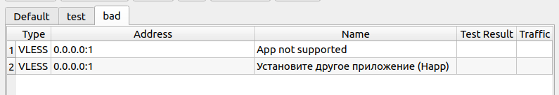
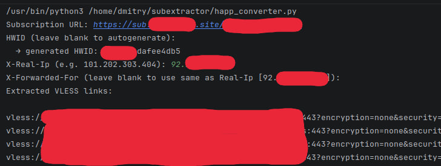

# Happ Converter

Инструмент для извлечения VLESS/Hysteria2/Trojan конфигов из Happ-подписок с встроенным сервером подписок и дешифрацией `happ://crypt*` ссылок.

---

> **Дисклеймер**
>
> Данный проект предоставлен **исключительно в образовательных и исследовательских целях**.
> Автор не несёт ответственности за любое использование этого инструмента, которое нарушает
> условия использования сторонних сервисов, законодательство вашей страны или права третьих лиц.
> Используйте только с данными, к которым у вас есть законный доступ.

---

### Мотивация

Почему просто не пользоваться Happ? У него нет открытого исходного кода (есть только [репозиторий-заглушка](https://github.com/Happ-proxy/happ-desktop)), а значит владелец проекта может делать что угодно — в том числе с вашим устройством.

Кроме того, некоторые провайдеры запрещают импортировать подписки в приложения, отличные от Happ:



---

## Возможности

- Получение VLESS-конфигов из Happ-подписок
- Дешифрация `happ://crypt`, `crypt2`, `crypt3`, `crypt4`, `crypt5` ссылок (Python-порт [happ-decrypt-universal](https://github.com/ivanovdd1/happ-decrypt-universal))
- Встроенный FastAPI-сервер подписок — импортируйте напрямую в Hiddify, Nekoray и другие клиенты
- Статический сайт-подписчик для деплоя на Netlify (`web-sub/`)

---

## Установка

```bash
git clone https://github.com/XuliGan4eg2006/Happ-converter
cd Happ-converter
pip3 install -r requirements.txt
```

---

## Запуск

```bash
python3 happ_converter.py
```

Скрипт запросит:

| Поле | Описание                                                                    |
|---|-----------------------------------------------------------------------------|
| Subscription URL | URL подписки (`https://...`) или зашифрованная ссылка (`happ://crypt5/...`) |
| HWID | ID устройства (по умолчанию — сгенерируется автоматически)                  |
| X-Real-Ip | IP-адрес для заголовка (определяется автоматически, см. ниже)               |
| X-Forwarded-For | IP-адрес для заголовка (по умолчанию = Real-Ip)                             |

Публичный IP определяется автоматически. Запрос уходит тем же путём, что и запрос подписки:
`requests` сам читает `HTTP_PROXY` / `HTTPS_PROXY` / `ALL_PROXY` (и `NO_PROXY`), поэтому с прокси
определится адрес выходного узла — тот самый, который увидит провайдер подписки, — а без прокси
ваш собственный:

```bash
HTTP_PROXY=http://127.0.0.1:12334/ python3 happ_converter.py   # через прокси
python3 happ_converter.py                                      # напрямую
```

Найденный адрес подставляется как значение по умолчанию для `X-Real-Ip` / `X-Forwarded-For`, его
всегда можно перебить вручную. Если определить IP не удалось, используется прежнее значение
по умолчанию.

При наличии сохранённых профилей скрипт сначала покажет их пронумерованный список — введите
номер, чтобы использовать профиль (URL и заголовки подставятся автоматически), или нажмите Enter,
чтобы пройти обычный опрос.

Также при обычном запуске можно ответить `y` на вопрос `Edit request headers?` и отредактировать
заголовки запроса перед отправкой.

По окончании скрипт выведет список VLESS-конфигов, предложит сохранить настройки как профиль
и запустить сервер подписок.



---

## Профили

Профиль хранит URL подписки и полный набор заголовков запроса. Профили лежат в `profiles.json`
рядом со скриптом (файл в `.gitignore` — он содержит ваши ссылки на подписки).

```
Saved profiles:
  1. home — https://sub.example.com/xxxxxxxx
  2. work — https://other.example.com/yyyyyyyy
Enter number to use a profile, 'e N' to edit, 'd N' to delete, or press Enter for a new setup.
```

| Команда | Действие |
|---|---|
| `N` | использовать профиль `N` |
| `e N` | редактировать профиль `N` (имя, URL, заголовки) |
| `d N` | удалить профиль `N` |
| `Enter` | обычный запуск без профиля |

### Редактор заголовков

Пункт `3. headers` в меню редактирования профиля открывает список заголовков:

```
Request headers:
  1. User-Agent: Happ/3.13.0
  2. X-Device-Os: Android
  ...
  8. X-Hwid: 0123456789abcdef
Enter number to change a header, 'a' to add, 'd N' to delete, Enter to finish.
```

| Команда | Действие |
|---|---|
| `N` | изменить значение заголовка `N` |
| `a` | добавить новый заголовок |
| `d N` | удалить заголовок `N` |
| `Enter` | закончить редактирование |

Значение `auto` вместо конкретного текста подставит автоматически определённый публичный IP —
удобно для `X-Real-Ip` и `X-Forwarded-For`.

Изменения сохраняются в `profiles.json` сразу. При запуске из профиля IP определяется заново: если он отличается от сохранённого, скрипт
спросит, подставить ли новый (`X-Forwarded-For` обновляется вместе с `X-Real-Ip`, если они
совпадали). Если во время запуска профиль был изменён (IP, HWID, заголовки), скрипт предложит
обновить его перед стартом сервера.

---

## Сервер подписок

После извлечения конфигов можно запустить локальный HTTP-сервер:

```
GET http://localhost:8080/    → plain-text подписка (для Hiddify / Nekoray / Ваш клиент)
GET http://localhost:8080/docs → Swagger UI
```

Вставьте `http://<ваш-ip>:8080/` как URL подписки в клиенте.

---

## Дешифрация happ://crypt* ссылок

Если URL подписки начинается с `happ://crypt`, скрипт автоматически расшифрует его перед запросом.

Поддерживаемые схемы: `crypt`, `crypt2`, `crypt3`, `crypt4`, `crypt5`.

Ключи хранятся в `assets/native_keys.json` и `assets/crypt5_final_keys.json`.

---

## Статический сайт для подписки (Netlify)

Папка `web-sub/` — готовый сайт для деплоя на Netlify.

1. Вставьте ваши VLESS-ссылки (по одной на строку) в файл `web-sub/sub/<ваш-секрет>`
2. Задеплойте папку `web-sub/` на [Netlify Drop](https://app.netlify.com/drop)
3. URL подписки: `https://ваш-сайт.netlify.app/sub/<ваш-секрет>`

---

## Структура проекта

```
happ_converter.py     — основной скрипт
parser.py             — парсинг JSON-ответа подписки в VLESS-ссылки
happ_decrypt.py       — дешифратор happ://crypt* (Python-порт)
converter.py          — конвертер VLESS URI → sing-box JSON
server.py             — FastAPI сервер подписок
assets/               — RSA-ключи для дешифрации
web-sub/              — статический сайт для Netlify
requirements.txt      — зависимости Python
```

---

## Credits

- [bubasik](https://gist.github.com/bubasik/af37247b71ca0b253161b48614aba61a) — оригинальный PHP-скрипт
- [happ-decrypt-universal](https://github.com/ivanovdd1/happ-decrypt-universal) — Rust-дешифратор happ://crypt*
